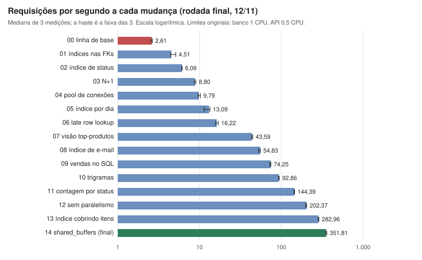
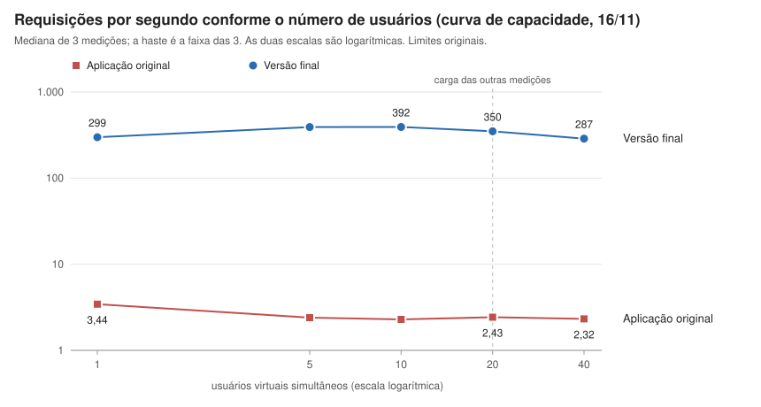

# De 2,6 para 474 requisições por segundo: por que a API saturava o banco e o que mudou

## 1. Resumo

A API de uma loja ficava lenta com 20 usuários simultâneos: o banco operava no teto da CPU e pelo menos 5% das requisições passavam de 25 segundos.
As causas eram consultas sem índice lendo tabelas inteiras, relatórios recalculados a cada chamada e uma conexão nova por consulta.
Das 17 mudanças testadas, as 15 que deram ganho foram mantidas.
Com os mesmos limites de CPU e memória, sem serviço novo e com as mesmas respostas, a API passou de 2,56 para 473,74 requisições por segundo (185,1×).

## 2. Contexto e diagnóstico

A API é escrita em Node.js e usa PostgreSQL.
O teste de carga simula 20 usuários, cada um pedindo a próxima requisição assim que recebe a resposta.
Na versão original, a API atendia 2,56 requisições por segundo, com p95 de 25.752,8 ms: 5% das requisições passavam disso.
O banco usava 99,4% do limite de CPU do seu container e a API, 13,2% do dela (medições [213731](../resultados/20261116-213731-17-pool-r2-original/resumo.txt), [213916](../resultados/20261116-213916-17-pool-r2-original/resumo.txt) e [214058](../resultados/20261116-214058-17-pool-r2-original/resumo.txt)): o gargalo era o banco.
Em preços do AWS Fargate, isso dá US$ 6,95 por milhão de requisições [[1]](https://aws.amazon.com/fargate/pricing/).

Para achar a causa, o `EXPLAIN ANALYZE` (mostra como o banco executa uma consulta e quanto leva cada passo) foi rodado em cada rota ([saída](../diagnostico/00-inicial/saida.txt)).
Só existiam os índices das chaves primárias.
Um índice leva direto às linhas procuradas, como o índice remissivo de um livro.
Sem eles, buscar os itens de um pedido lia 1,5 milhão de linhas (252 ms, sem carga).
Depois de cada mudança, o ranking das consultas mais pesadas foi refeito sob carga, com o `pg_stat_statements` [[2]](https://www.postgresql.org/docs/16/pgstatstatements.html).

Hipótese de causa:

- Faltavam índices: buscas por cliente, status, dia, e-mail e trecho do nome liam tabelas inteiras.
- `/clientes/:id/pedidos` fazia uma consulta por pedido e outra por item (o problema N+1), cada uma numa conexão nova.
- A paginação de `/pedidos` lia da tabela as linhas que o `OFFSET` descartava.
- Relatórios eram recalculados a cada chamada.
- Nos diagnósticos seguintes: a configuração padrão do PostgreSQL não combinava com 1 CPU, porque consultas paralelas dividiam o limite e o cache era menor que a tabela mais usada.

## 3. Estado da arte

### Índices e acesso aos dados

A documentação do PostgreSQL avisa que declarar uma chave estrangeira não cria índice nas colunas que fazem a referência, e recomenda criá-lo [[3]](https://www.postgresql.org/docs/16/ddl-constraints.html#DDL-CONSTRAINTS-FK).
Sem índice, o banco lê a tabela inteira, linha por linha; em troca, cada índice deixa as escritas mais caras [[4]](https://www.postgresql.org/docs/16/indexes-intro.html).
Há também índices sobre expressões, como `lower(email)` [[5]](https://www.postgresql.org/docs/16/indexes-expressional.html), de trigramas, para buscas por trecho [[6]](https://www.postgresql.org/docs/16/pgtrgm.html), e com colunas extras, que dispensam a leitura da tabela [[7]](https://www.postgresql.org/docs/16/indexes-index-only-scans.html).

### Menos idas ao banco e menos trabalho repetido

Para o N+1, a solução mais citada é agrupar as buscas, como faz a biblioteca DataLoader [[8]](https://github.com/graphql/dataloader#batching); o guia do Rails mostra o mesmo exemplo caindo para 2 consultas [[9]](https://guides.rubyonrails.org/active_record_querying.html#n-1-queries-problem).
A Shopify relata ter criado uma biblioteca de agrupamento para reduzir as consultas da sua API, sem publicar números [[10]](https://shopify.engineering/solving-the-n-1-problem-for-graphql-through-batching).
Um estudo sobre aplicações com ORM (camada que traduz objetos em SQL) encontrou esse padrão; corrigir esse e outros anti-padrões reduziu o tempo de resposta em até 98% [[11]](https://ece.uwaterloo.ca/~wshang/pubs/peter_icse2014.pdf).
Para relatórios, a visão materializada guarda o resultado pronto: a leitura fica muito mais rápida, mas os dados podem estar desatualizados [[12]](https://www.postgresql.org/docs/16/rules-materializedviews.html).

### Conexões e concorrência

No PostgreSQL, cada conexão cria um processo novo no servidor [[13]](https://www.postgresql.org/docs/16/connect-estab.html), e abrir uma conexão pode levar de 20 a 30 ms [[14]](https://node-postgres.com/features/pooling).
Um pool de conexões mantém algumas abertas e as reaproveita.
A wiki do HikariCP, um pool para Java, recomenda um pool pequeno, perto do dobro dos núcleos de CPU [[15]](https://github.com/brettwooldridge/HikariCP/wiki/About-Pool-Sizing).
Um estudo acadêmico mostrou que limitar as transações simultâneas no banco evita a queda de vazão; com 1 CPU, o pico ficou perto de 5 (bancos DB2 e Shore, com escrita) [[16]](https://www.cs.cmu.edu/~harchol/Papers/icde06.pdf).
Num teste da Percona, 14 conexões num servidor de 56 CPUs renderam quase tanto quanto pools maiores [[17]](https://www.percona.com/blog/scaling-postgresql-with-pgbouncer-you-may-need-a-connection-pooler-sooner-than-you-expect/).

### Como medir

A carga deste desafio é de ciclo fechado: a fila nunca passa do número de usuários, e os tempos saem menores que com tráfego aberto [[18]](https://www.usenix.org/legacy/event/nsdi06/tech/full_papers/schroeder/schroeder.pdf).
Um estudo com 835 servidores mostrou que o mesmo programa varia de uma execução para outra e defende usar a mediana e embaralhar a ordem dos testes [[19]](https://www.usenix.org/system/files/osdi18-maricq.pdf).

## 4. Alternativas consideradas

| Alternativa | Custo | Desempenho | Risco | Esforço |
| --- | --- | --- | --- | --- |
| Índices, consultas reescritas e pool de conexões | Nenhum serviço novo; índices ocupam espaço (o de e-mail, ~4,8 MB) e encarecem as escritas [[4]](https://www.postgresql.org/docs/16/indexes-intro.html) | Ataca a causa; ex.: busca por e-mail de 29,3 para 0,08 ms (pré-teste) | Baixo: respostas conferidas pelo verificador de contrato em cada medição | Baixo: um `.sql` ou uma rota por mudança |
| Relatórios pré-calculados (visões materializadas) | ~2 MB e ~1 s de banco a cada atualização (`top-produtos`) | `top-produtos` de 1.758,8 para 0,1 ms (pré-teste) | Médio: dados desatualizados entre atualizações [[12]](https://www.postgresql.org/docs/16/rules-materializedviews.html) | Baixo a médio |
| Cache de respostas (Redis) | Serviço novo: CPU, memória e mais um container | Alto só para requisições repetidas, e a carga sorteia entre 100 mil clientes (esperado) | Médio: invalidação; na busca, enviesaria a medição | Médio a alto |
| Pooler externo (PgBouncer) | Serviço novo | Parecido com o pool dentro da API, que aqui é um processo só (esperado) | Médio: mais uma peça para operar | Médio |
| Mais CPU e memória | Cresce com o recurso: US$ 0,04048 por CPU por hora [[1]](https://aws.amazon.com/fargate/pricing/) | Não medido | Baixo para operar | Trivial |

A tabela compara cinco caminhos para o mesmo problema: o banco no teto de CPU.
Os números de desempenho vêm de pré-testes feitos sem carga, antes de cada mudança; "esperado" marca o que não foi medido, e o resultado sob carga está na seção 6.
Dois critérios eliminaram opções antes do custo: as respostas da API não podiam mudar, e nenhuma mudança podia ganhar só porque a carga de teste é previsível.
Por isso o cache na busca foi descartado: a carga usa 12 termos fixos, e o cache acertaria quase sempre, o que não representa usuários reais.
Mais CPU e memória não foi testado na aplicação original.
Leitura deste trabalho: o recurso extra custaria mais por hora e deixaria a causa no lugar.
A comparação completa, com as variantes de cada problema (índice GiST, busca textual, paginação por cursor, entre outras), está no [diário](../notas/diario-de-bordo.md#alternativas).

## 5. Solução escolhida e por quê

A solução escolhida foi atacar a causa no banco e nas consultas, sem serviço novo: índices, consultas reescritas, os dois relatórios pré-calculados em visões materializadas e um pool de conexões pequeno.
As mudanças foram aplicadas uma por vez, guiadas pelo ranking de tempo do banco, e cada uma foi medida antes da seguinte, para que cada ganho tivesse uma causa conhecida.
O argumento vem do diagnóstico: o banco gastava a CPU com trabalho que um índice ou uma reescrita elimina, como ler 1,5 milhão de linhas para achar os itens de um pedido.
Corrigir isso não exige infraestrutura nova nem muda as respostas da API.
O estudo de custo reforça a escolha: com um quarto da CPU, a versão até o experimento 16 fez 68,44 requisições por segundo, 29 vezes a aplicação original com toda a CPU, na mesma sessão ([estudo de custo](../experimentos.md#estudo-de-custo-quanto-recurso-a-versão-final-precisa)).
Leitura deste trabalho: faltava eficiência, não máquina.
O cache de respostas foi descartado por ser um serviço novo com pouco acerto nesta carga; o PgBouncer, por só compensar com várias instâncias da API, e aqui há uma; mais CPU, por aumentar o custo sem mexer na causa.

## 6. Experimento e resultado

Cada linha compara a mudança com o passo anterior, medidos na mesma sessão: mediana de 3 medições, 20 usuários, mesmos limites de CPU e memória ([como ler e pastas do "antes"](../experimentos.md#mudanças-uma-a-uma)).

<!-- gerado:experimentos -->
| Mudança | Hipótese | p95 antes → depois | req/s antes → depois | CPU, % do limite · memória, MiB (banco · API) | Pastas de resultados (depois) | Conclusão |
| --- | --- | --- | --- | --- | --- | --- |
| [01](../notas/diario-de-bordo.md#01-indices-fk) Índices nas chaves estrangeiras `pedidos (cliente_id)` e `itens_pedido (pedido_id)` | Sem índice, cada busca de pedidos e de itens lê as tabelas inteiras. | 46.763,0 → 21.153,9 ms (−54,8%) | 1,53 → 2,73 (+78,4%) | CPU 98,5 → 97,6 · 14,0 → 25,4 memória 396,2 → 383,4 · 31,3 → 39,7 | [172652](../resultados/20261105-172652-01-indices-fk/resumo.txt) [173051](../resultados/20261105-173051-01-indices-fk/resumo.txt) [173531](../resultados/20261105-173531-01-indices-fk/resumo.txt) | Ganho. As rotas que buscam pedidos e itens deixam de ler as tabelas inteiras. Custo: espaço dos índices e escrita mais cara (a API só lê; não medido). |
| [02](../notas/diario-de-bordo.md#02-indice-pedidos-status) Índice `pedidos (status, criado_em DESC, id DESC)` para a página de `/pedidos` | A página de `/pedidos` ordena em disco a cada chamada; o índice entrega as linhas já na ordem. | 21.153,9 → 17.306,0 ms (−18,2%) | 2,73 → 3,87 (+41,8%) | CPU 97,6 → 95,9 · 25,4 → 29,8 memória 383,4 → 412,9 · 39,7 → 39,2 | [185715](../resultados/20261105-185715-02-indice-pedidos-status/resumo.txt) [190052](../resultados/20261105-190052-02-indice-pedidos-status/resumo.txt) [190307](../resultados/20261105-190307-02-indice-pedidos-status/resumo.txt) | Ganho. O índice casa com o `ORDER BY` e tira a ordenação; o `count(*)` do total continua caro (resolvido no 11). |
| [03](../notas/diario-de-bordo.md#03-n-mais-1) N+1 de `/clientes/:id/pedidos` trocado por uma consulta com `JOIN` | A rota vai ao banco uma vez por pedido e por item; uma consulta com `JOIN` reduz isso a duas idas. | 17.306,0 → 19.467,3 ms (+12,5%) | 3,87 → 5,63 (+45,5%) | CPU 95,9 → 97,3 · 29,8 → 34,6 memória 412,9 → 396,8 · 39,2 → 56,3 | [192107](../resultados/20261105-192107-03-n-mais-1/resumo.txt) [192320](../resultados/20261105-192320-03-n-mais-1/resumo.txt) [192602](../resultados/20261105-192602-03-n-mais-1/resumo.txt) | Ganho na rota e na vazão. O p95 geral piorou: com a carga em ciclo fechado, a fila foi para os relatórios. |
| [04](../notas/diario-de-bordo.md#04-pool-conexoes) `pg.Pool` (`max: 20`) no lugar de uma conexão nova por consulta | Uma conexão nova por consulta gasta CPU do banco criando processo e fazendo o handshake. | 13.004,4 → 13.042,1 ms (+0,3%) | 8,44 → 9,43 (+11,7%) | CPU 100,4 → 100,3 · 30,6 → 34,2 memória 411,8 → 416,7 · 58,4 → 75,2 | [194137](../resultados/20261109-194137-04-pool-conexoes/resumo.txt) [194359](../resultados/20261109-194359-04-pool-conexoes/resumo.txt) [194912](../resultados/20261109-194912-04-pool-conexoes/resumo.txt) | Ganho. Menos conexões e processos novos no PostgreSQL; a mediana caiu muito, o p95 continuou decidido pelos relatórios. |
| [05](../notas/diario-de-bordo.md#05-indice-vendas-por-dia) Índice de expressão `pedidos ((criado_em::date))` | O filtro por dia lê todos os pedidos a cada chamada; um índice na expressão `criado_em::date` evita isso. | 13.042,1 → 8.445,2 ms (−35,2%) | 9,43 → 11,19 (+18,7%) | CPU 100,3 → 97,2 · 34,2 → 36,8 memória 416,7 → 423,6 · 75,2 → 48,0 | [201718](../resultados/20261109-201718-05-indice-vendas-por-dia/resumo.txt) [202101](../resultados/20261109-202101-05-indice-vendas-por-dia/resumo.txt) [203110](../resultados/20261109-203110-05-indice-vendas-por-dia/resumo.txt) | Ganho. `vendas-por-dia` deixa de varrer `pedidos`; o p99 geral piorou porque a fila passou para `top-produtos` e `pedidos-por-status`. |
| [06](../notas/diario-de-bordo.md#06-pedidos-late-lookup) Late row lookup na página de `/pedidos` (o `OFFSET` anda só no índice) | O `OFFSET` busca na tabela as linhas que vai descartar; pegar só os `id` pelo índice evita isso. | 8.445,2 → 6.855,3 ms (−18,8%) | 11,19 → 14,32 (+28,0%) | CPU 97,2 → 96,5 · 36,8 → 42,8 memória 423,6 → 434,3 · 48,0 → 78,7 | [211748](../resultados/20261109-211748-06-pedidos-late-lookup/resumo.txt) [211938](../resultados/20261109-211938-06-pedidos-late-lookup/resumo.txt) [212142](../resultados/20261109-212142-06-pedidos-late-lookup/resumo.txt) | Ganho. As linhas puladas pelo `OFFSET` não são mais lidas da tabela; a cauda de `pedidos-por-status` some. |
| [07](../notas/diario-de-bordo.md#07-top-produtos-visao-materializada) Visão materializada com o resumo de vendas por produto | `top-produtos` agrega todos os itens a cada chamada; um resumo pré-calculado elimina esse trabalho. | 6.855,3 → 1.404,0 ms (−79,5%) | 14,32 → 39,30 (2,7×) | CPU 96,5 → 86,9 · 42,8 → 89,2 memória 434,3 → 478,3 · 78,7 → 47,8 | [213632](../resultados/20261109-213632-07-top-produtos-visao-materializada/resumo.txt) [213755](../resultados/20261109-213755-07-top-produtos-visao-materializada/resumo.txt) [213918](../resultados/20261109-213918-07-top-produtos-visao-materializada/resumo.txt) | Maior ganho do trabalho. É o melhor caso: os dados nunca mudam aqui, e o custo do `REFRESH` sob carga não foi medido (próximos testes). |
| [08](../notas/diario-de-bordo.md#08-indice-email) Índice de expressão `clientes (lower(email))` | A busca por `lower(email)` lê todos os clientes; um índice na expressão evita isso. | 1.404,0 → 1.198,9 ms (−14,6%) | 39,30 → 45,40 (+15,5%) | CPU 86,9 → 62,9 · 89,2 → 96,4 memória 478,3 → 451,4 · 47,8 → 45,5 | [215711](../resultados/20261109-215711-08-indice-email/resumo.txt) [215833](../resultados/20261109-215833-08-indice-email/resumo.txt) [215955](../resultados/20261109-215955-08-indice-email/resumo.txt) | Ganho. O banco deixa de ser o gargalo e a API passa a ser (CPU da API no teto da cota). |
| [09](../notas/diario-de-bordo.md#09-vendas-agregada-no-sql) `vendas-por-dia` agregada no SQL (`GROUP BY`) em vez de no Node | A API gasta CPU analisando milhares de linhas que o SQL pode devolver já agregadas. | 1.198,9 → 899,6 ms (−25,0%) | 45,40 → 73,51 (+61,9%) | CPU 62,9 → 98,5 · 96,4 → 19,6 memória 451,4 → 459,8 · 45,5 → 26,7 | [222257](../resultados/20261109-222257-09-vendas-agregada-no-sql/resumo.txt) [222417](../resultados/20261109-222417-09-vendas-agregada-no-sql/resumo.txt) [222536](../resultados/20261109-222536-09-vendas-agregada-no-sql/resumo.txt) | Ganho. A API sai do teto de CPU e o gargalo volta ao banco; equivalência do JSON provada em todas as janelas da carga. A cauda da própria rota piorou: ela passou a ser mais chamada, num banco de novo saturado. |
| [10](../notas/diario-de-bordo.md#10-busca-trigramas) Índice GIN `pg_trgm` em `produtos.nome` | A busca por trecho compara todos os nomes; um índice de trigramas visita só os candidatos. | 899,6 → 809,8 ms (−10,0%) | 73,51 → 91,15 (+24,0%) | CPU 98,5 → 98,9 · 19,6 → 24,2 memória 459,8 → 463,6 · 26,7 → 26,2 | [223641](../resultados/20261109-223641-10-busca-trigramas/resumo.txt) [223801](../resultados/20261109-223801-10-busca-trigramas/resumo.txt) [223920](../resultados/20261109-223920-10-busca-trigramas/resumo.txt) | Ganho. A busca por trecho (`ILIKE '%termo%'`) passa a usar índice, com resultado provado igual. |
| [11](../notas/diario-de-bordo.md#11-contagem-por-status) Contagem de pedidos por status numa visão materializada | O total de `/pedidos` conta todos os pedidos do status a cada página; uma contagem pré-calculada evita isso. | 809,8 → 605,1 ms (−25,3%) | 91,15 → 139,13 (+52,6%) | CPU 98,9 → 98,6 · 24,2 → 29,8 memória 463,6 → 476,3 · 26,2 → 27,2 | [224702](../resultados/20261109-224702-11-contagem-por-status/resumo.txt) [224822](../resultados/20261109-224822-11-contagem-por-status/resumo.txt) [224942](../resultados/20261109-224942-11-contagem-por-status/resumo.txt) | Ganho. O total da página deixa de contar todos os pedidos do status a cada chamada; mesma ressalva de dados estáticos do 07. |
| [12](../notas/diario-de-bordo.md#12-sem-paralelismo) `max_parallel_workers_per_gather=0` | Com 1 CPU, os processos paralelos de uma consulta só dividem a mesma cota e pagam a coordenação. | 605,1 → 393,0 ms (−35,1%) | 139,13 → 227,59 (+63,6%) | CPU 98,6 → 99,9 · 29,8 → 42,4 memória 476,3 → 222,4 · 27,2 → 27,4 | [230625](../resultados/20261109-230625-12-sem-paralelismo/resumo.txt) [230744](../resultados/20261109-230744-12-sem-paralelismo/resumo.txt) [230904](../resultados/20261109-230904-12-sem-paralelismo/resumo.txt) | Ganho. Com 1 CPU de limite, os workers paralelos só dividiam a mesma cota; as rotas baratas saem do degrau de throttling. |
| [13](../notas/diario-de-bordo.md#13-indice-cobrindo-itens) Índice `itens_pedido (pedido_id) INCLUDE (quantidade, preco_unitario_centavos)` no lugar do índice do 01 | `vendas-por-dia` visita a tabela de itens; um índice com as colunas usadas responde sozinho. | 409,3 → 345,6 ms (−15,6%) | 194,89 → 219,74 (+12,8%) | CPU 98,2 → 100,1 · 45,2 → 53,4 memória 487,2 → 456,8 · 27,5 → 27,7 | [170935](../resultados/20261111-170935-13-indice-cobrindo-itens/resumo.txt) [171055](../resultados/20261111-171055-13-indice-cobrindo-itens/resumo.txt) [171216](../resultados/20261111-171216-13-indice-cobrindo-itens/resumo.txt) | Ganho. `vendas-por-dia` lê só o índice e o planejador deixa de escolher a varredura completa em algumas janelas. |
| [14](../notas/diario-de-bordo.md#14-shared-buffers-256mb) `shared_buffers=256MB` (padrão 128 MB) | A tabela `pedidos` e os índices mais usados não cabem no cache padrão do PostgreSQL. | 345,6 → 204,8 ms (−40,7%) | 219,74 → 298,89 (+36,0%) | CPU 100,1 → 100,1 · 53,4 → 59,0 memória 456,8 → 439,8 · 27,7 → 27,9 | [172915](../resultados/20261111-172915-14-shared-buffers-256mb/resumo.txt) [173035](../resultados/20261111-173035-14-shared-buffers-256mb/resumo.txt) [173155](../resultados/20261111-173155-14-shared-buffers-256mb/resumo.txt) | Ganho. A tabela `pedidos` e os índices mais usados cabem no cache do PostgreSQL. Custo: memória fixa a mais no banco, acima da faixa de 25–40% da documentação. |
| [15](../notas/diario-de-bordo.md#15-shared-buffers-192mb) `shared_buffers=192MB` (dentro dos 40% da documentação) (desfeita) | Um cache menor, dentro da faixa da documentação, pode render perto do de 256 MB. | 204,8 → 212,1 ms (+3,6%) | 298,89 → 257,43 (−13,9%) | CPU 100,1 → 100,5 · 59,0 → 60,6 memória 439,8 → 462,3 · 27,9 → 28,0 | [181323](../resultados/20261111-181323-15-shared-buffers-192mb/resumo.txt) [181443](../resultados/20261111-181443-15-shared-buffers-192mb/resumo.txt) [181604](../resultados/20261111-181604-15-shared-buffers-192mb/resumo.txt) | Pior que 256 MB. Desfeito: neste ambiente o ganho exige passar da recomendação. |
| [16](../notas/diario-de-bordo.md#16-indice-cobrindo-pedidos) Índice `pedidos ((criado_em::date)) INCLUDE (criado_em, id, status)` (desfeita) | Um índice que cobre `pedidos` tira de `vendas-por-dia` as visitas à tabela. | 204,8 → 195,9 ms (−4,3%) | 298,89 → 294,48 (−1,5%) | CPU 100,1 → 99,7 · 59,0 → 64,8 memória 439,8 → 417,1 · 27,9 → 27,7 | [182805](../resultados/20261111-182805-16-indice-cobrindo-pedidos/resumo.txt) [182926](../resultados/20261111-182926-16-indice-cobrindo-pedidos/resumo.txt) [183047](../resultados/20261111-183047-16-indice-cobrindo-pedidos/resumo.txt) | Sem ganho de vazão (faixas sobrepostas) e um índice maior disputando o cache. Desfeito. |
| [17](../notas/diario-de-bordo.md#17-tamanho-do-pool) Pool de conexões da API com `max: 3` no lugar de 20 | Menos consultas ao mesmo tempo disputam menos a única CPU do banco; as outras esperam na fila do pool. | 190,8 → 91,6 ms (−52,0%) | 354,05 → 473,74 (+33,8%) | CPU 100,2 → 100,0 · 60,8 → 79,2 memória 455,5 → 405,2 · 28,7 → 27,3 | [211822](../resultados/20261116-211822-17-pool-r2-max-03/resumo.txt) [212645](../resultados/20261116-212645-17-pool-r2-max-03/resumo.txt) [213055](../resultados/20261116-213055-17-pool-r2-max-03/resumo.txt) | Ganho, reproduzido em duas rodadas. Menos consultas ao mesmo tempo gastam menos CPU do banco por requisição; as demais esperam na fila do pool. 2 e 3 empatam em vazão, 3 tem mediana menor; com 1, a CPU do banco fica ociosa. A API passa a ser o próximo limite. |
<!-- /gerado:experimentos -->

Os ganhos de linhas diferentes não se somam, porque o ambiente variou até 50% de um dia para outro.
Por isso, a cadeia foi refeita numa sessão só (12/11): a versão anterior ao experimento 17 fez 351,81 requisições por segundo, 134,8 vezes a original ([rodada final](../experimentos.md#rodada-final-a-cadeia-inteira-numa-sessão-só)).
Duas mudanças foram desfeitas: o cache de 192 MB (15) rendeu menos que o de 256 MB, e o índice que cobre `pedidos` (16) não mudou a vazão.
No experimento 03, a rota corrigida acelerou, mas o p95 geral piorou: na carga de ciclo fechado, os usuários liberados foram esperar nos relatórios lentos.

No experimento 17, o melhor pool teve 3 conexões, perto da fórmula do HikariCP para 1 núcleo [[15]](https://github.com/brettwooldridge/HikariCP/wiki/About-Pool-Sizing) e abaixo do pico perto de 5 do estudo [[16]](https://www.cs.cmu.edu/~harchol/Papers/icde06.pdf), com a CPU do banco por requisição caindo de 2,83 para 2,11 ms ([experimento 17](../experimentos.md#experimento-17-tamanho-do-pool-em-duas-rodadas)).
Leitura deste trabalho: mesmo sem travas, consultas demais ao mesmo tempo disputam a única CPU.
Contra a original, na mesma sessão (16/11), as requisições por segundo subiram 185,1 vezes e o custo por milhão caiu de US$ 6,95 para 0,038.
O segundo gráfico mostra que o ganho depende do número de usuários.

## 7. Limites e testes futuros

A maior fraqueza é que os dados de teste nunca mudam.
As visões materializadas (07 e 11) foram medidas no melhor caso: o custo de atualizá-las sob carga não foi medido, e com dados mudando o resultado fica desatualizado entre atualizações [[12]](https://www.postgresql.org/docs/16/rules-materializedviews.html).
A API também só lê, então o custo que os índices somam às escritas [[4]](https://www.postgresql.org/docs/16/indexes-intro.html) não aparece aqui.
Todas as medições rodaram numa máquina só, com carga sintética de ciclo fechado; com tráfego aberto e a mesma carga, os tempos tendem a ser maiores [[18]](https://www.usenix.org/legacy/event/nsdi06/tech/full_papers/schroeder/schroeder.pdf).
O pool de 3 foi testado só com 20 usuários e rede local, e pode perder para pools maiores com mais latência entre a API e o banco (não medido).

Três resultados derrubariam a conclusão: atualizar as visões sob carga custar mais do que elas economizam; um teste com escritas mostrar os índices custando mais do que ganham; ou o pool de 3 perder para o de 20 com latência de rede real.
Esses testes, e a API como próximo limite (79,2% do seu limite de CPU no experimento 17), estão no [`proximos-testes.md`](../proximos-testes.md).

## 8. Referências

1. Amazon Web Services. AWS Fargate Pricing (Linux/x86, US East). https://aws.amazon.com/fargate/pricing/. Acesso em 11 nov. 2026.
2. PostgreSQL Global Development Group. PostgreSQL 16 Documentation, F.32 pg_stat_statements. https://www.postgresql.org/docs/16/pgstatstatements.html. Acesso em 5 nov. 2026.
3. PostgreSQL Global Development Group. PostgreSQL 16 Documentation, 5.4.5 Foreign Keys. https://www.postgresql.org/docs/16/ddl-constraints.html#DDL-CONSTRAINTS-FK. Acesso em 5 nov. 2026.
4. PostgreSQL Global Development Group. PostgreSQL 16 Documentation, 11.1 Indexes: Introduction. https://www.postgresql.org/docs/16/indexes-intro.html. Acesso em 5 nov. 2026.
5. PostgreSQL Global Development Group. PostgreSQL 16 Documentation, 11.7 Indexes on Expressions. https://www.postgresql.org/docs/16/indexes-expressional.html. Acesso em 9 nov. 2026.
6. PostgreSQL Global Development Group. PostgreSQL 16 Documentation, F.35 pg_trgm. https://www.postgresql.org/docs/16/pgtrgm.html. Acesso em 9 nov. 2026.
7. PostgreSQL Global Development Group. PostgreSQL 16 Documentation, 11.9 Index-Only Scans and Covering Indexes. https://www.postgresql.org/docs/16/indexes-index-only-scans.html. Acesso em 11 nov. 2026.
8. GraphQL Foundation. DataLoader, README, seção "Batching". https://github.com/graphql/dataloader#batching. Acesso em 5 nov. 2026.
9. Rails Guides. Active Record Query Interface, "N + 1 Queries Problem". https://guides.rubyonrails.org/active_record_querying.html#n-1-queries-problem. Acesso em 16 nov. 2026.
10. Leanne Shapton, Dylan Thacker-Smith e Scott Walkinshaw (Shopify Engineering). Solving the N+1 Problem for GraphQL through Batching, 2018. https://shopify.engineering/solving-the-n-1-problem-for-graphql-through-batching. Acesso em 18 nov. 2026.
11. Tse-Hsun Chen, Weiyi Shang, Zhen Ming Jiang, Ahmed E. Hassan, Mohamed Nasser e Parminder Flora. Detecting Performance Anti-patterns for Applications Developed using Object-Relational Mapping. ICSE '14. https://ece.uwaterloo.ca/~wshang/pubs/peter_icse2014.pdf. Acesso em 12 nov. 2026.
12. PostgreSQL Global Development Group. PostgreSQL 16 Documentation, 41.3 Materialized Views. https://www.postgresql.org/docs/16/rules-materializedviews.html. Acesso em 9 nov. 2026.
13. PostgreSQL Global Development Group. PostgreSQL 16 Documentation, 52.2 How Connections Are Established. https://www.postgresql.org/docs/16/connect-estab.html. Acesso em 5 nov. 2026.
14. node-postgres. Pooling. https://node-postgres.com/features/pooling. Acesso em 5 nov. 2026.
15. Brett Wooldridge. HikariCP wiki, About Pool Sizing. https://github.com/brettwooldridge/HikariCP/wiki/About-Pool-Sizing. Acesso em 5 nov. 2026.
16. Bianca Schroeder, Mor Harchol-Balter, Adam Wierman, Arun Iyengar e Erich Nahum. How to Determine a Good Multi-Programming Level for External Scheduling. ICDE 2006. https://www.cs.cmu.edu/~harchol/Papers/icde06.pdf. Acesso em 16 nov. 2026.
17. Fernando Laudares Camargos (Percona). Scaling PostgreSQL with PgBouncer: You May Need a Connection Pooler, 2018. https://www.percona.com/blog/scaling-postgresql-with-pgbouncer-you-may-need-a-connection-pooler-sooner-than-you-expect/. Acesso em 18 nov. 2026.
18. Bianca Schroeder, Adam Wierman e Mor Harchol-Balter. Open Versus Closed: A Cautionary Tale. NSDI '06. https://www.usenix.org/legacy/event/nsdi06/tech/full_papers/schroeder/schroeder.pdf. Acesso em 12 nov. 2026.
19. Aleksander Maricq, Dmitry Duplyakin, Ivo Jimenez, Carlos Maltzahn, Ryan Stutsman e Robert Ricci. Taming Performance Variability. OSDI '18. https://www.usenix.org/system/files/osdi18-maricq.pdf. Acesso em 12 nov. 2026.

## 9. Uso de IA

O Claude Code (Anthropic) foi usado em todo o trabalho: escreveu os scripts de diagnóstico e de medição em lote, implementou a pedido os experimentos 07 a 16, planejou o 17, escreveu o `analise/gerar.py` e redigiu a maior parte deste artigo, com revisão do autor.
A verificação: o verificador de contrato passou nas 186 medições, todo número das tabelas é gerado das pastas de `resultados/`, e as fontes foram conferidas no navegador, exceto [10] e [17], lidas só por leitura automática.
A lista completa, com o que foi verificado em cada passo, está no [diário](../notas/diario-de-bordo.md#uso-de-ia).
