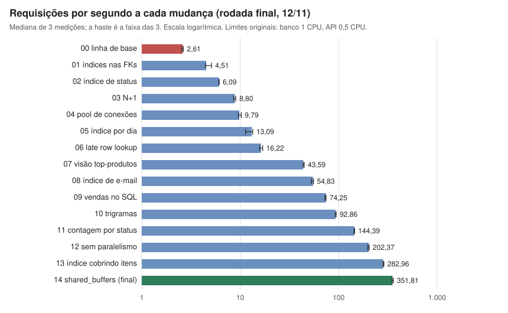
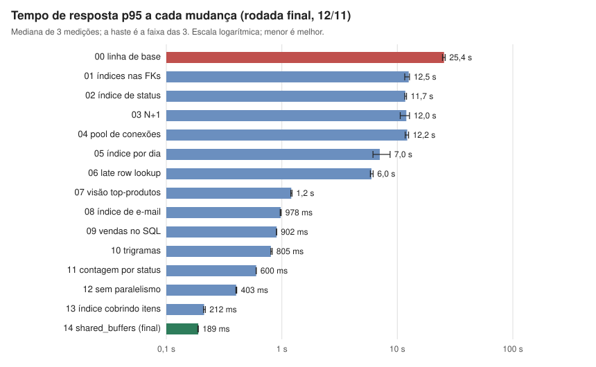
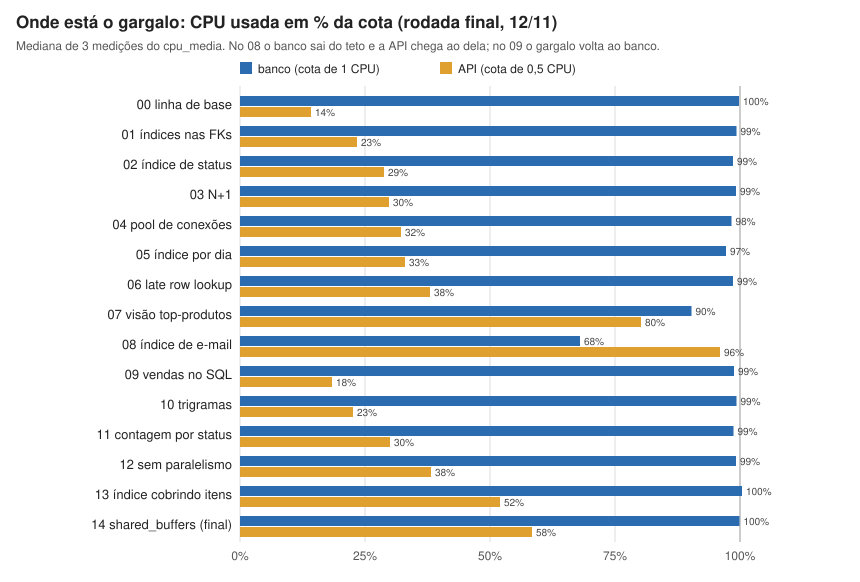
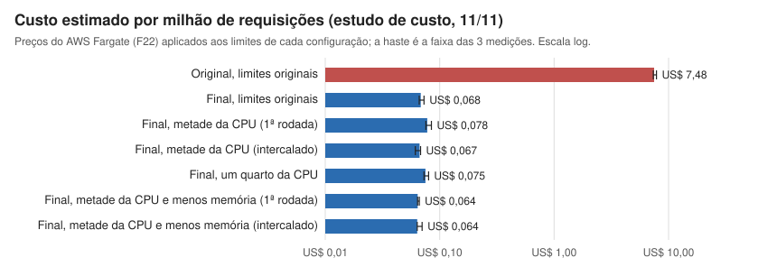

# Experimentos

Uma linha por ideia aplicada: fonte, status, antes, depois, pastas de resultados e conclusão. As ideias pesquisadas e não testadas estão em [`proximos-testes.md`](proximos-testes.md). O registro completo de cada experimento (hipótese escrita antes de medir, previsões, evidência de diagnóstico, resultado por rota) está no [diário de bordo](notas/diario-de-bordo.md); o número de cada linha leva até lá.

**De onde vêm os números.** Todo número das tabelas abaixo é gerado por [`analise/gerar.py`](analise/gerar.py) a partir dos arquivos que o `scripts/medir.sh` gravou em `resultados/`. O script só lê essas pastas. Para regenerar as tabelas e os gráficos: `python3 analise/gerar.py` (só biblioteca padrão). O texto fora dos blocos gerados é escrito à mão.

<!-- gerado:verificacao -->
Conferido por `analise/gerar.py`: 126 pastas lidas, todas com `arquivos alterados sem commit: 0` e "Contrato mantido".
<!-- /gerado:verificacao -->

**Como ler:**

- **Antes:** a mudança anterior, medida na mesma sessão que o depois. O ambiente muda entre dias (o mesmo código variou até 50% de um dia para o outro), então, quando o antes era de outro dia, ele foi medido de novo: o 03 em 09/11 (antes do 04) e o 12 em 11/11 (antes do 13).
- **Valores:** mediana das 3 medições de cada valor (req/s, p95, CPU e memória, cada um separado).
- **Faixas de req/s:** "separadas" quando as 3 medições do depois ficam todas acima (ou todas abaixo) das 3 do antes; "sobrepostas" quando não dá para separar da variação entre execuções.
- **CPU:** `cpu_media` do `recursos.txt` dividido pela cota do container (banco 1 CPU, API 0,5 CPU nos limites originais); 100% é o teto.
- **Memória:** `mem_media` do `recursos.txt`. Inclui o cache de arquivos que o kernel guarda para o container, então sobe e desce com o preparo do banco (por exemplo, recriado por um diagnóstico entre o 11 e o 12) e não é só memória que o PostgreSQL precisa; a decomposição está no Diagnóstico 05 do diário.
- **Carga:** 20 usuários virtuais por 60 s, semente 42, a mesma em todas as medições (registrado no `contexto.txt` de cada pasta).

## Mudanças, uma a uma

<!-- gerado:experimentos -->
| # | Mudança | Fonte | Status | Antes | req/s antes → depois | p95 geral antes → depois | p95 da rota-alvo antes → depois | CPU, % da cota (banco · API) | Memória, MiB (banco · API) | Faixas de req/s | Pastas | Conclusão |
| --- | --- | --- | --- | --- | --- | --- | --- | --- | --- | --- | --- | --- |
| [01](notas/diario-de-bordo.md#01-indices-fk) | Índices nas chaves estrangeiras `pedidos (cliente_id)` e `itens_pedido (pedido_id)` | F1, F2 | Aplicada e medida | linha de base | 1,53 → 2,73 (+78,4%) | 46.763,0 → 21.153,9 ms (−54,8%) | `pedidos-do-cliente`: 52.967,0 → 21.137,4 ms (−60,1%) | 98,5 → 97,6 · 14,0 → 25,4 | 396,2 → 383,4 · 31,3 → 39,7 | separadas | antes: [165057](resultados/20261105-165057-00-linha-de-base/resumo.txt) [165331](resultados/20261105-165331-00-linha-de-base/resumo.txt) [165546](resultados/20261105-165546-00-linha-de-base/resumo.txt) depois: [172652](resultados/20261105-172652-01-indices-fk/resumo.txt) [173051](resultados/20261105-173051-01-indices-fk/resumo.txt) [173531](resultados/20261105-173531-01-indices-fk/resumo.txt) | Ganho. As rotas que buscam pedidos e itens deixam de ler as tabelas inteiras. Custo: espaço dos índices e escrita mais cara (a API só lê; não medido). |
| [02](notas/diario-de-bordo.md#02-indice-pedidos-status) | Índice `pedidos (status, criado_em DESC, id DESC)` para a página de `/pedidos` | F4, F3 | Aplicada e medida | exp. 01 | 2,73 → 3,87 (+41,8%) | 21.153,9 → 17.306,0 ms (−18,2%) | `pedidos-por-status`: 26.701,1 → 14.612,2 ms (−45,3%) | 97,6 → 95,9 · 25,4 → 29,8 | 383,4 → 412,9 · 39,7 → 39,2 | separadas | antes: [172652](resultados/20261105-172652-01-indices-fk/resumo.txt) [173051](resultados/20261105-173051-01-indices-fk/resumo.txt) [173531](resultados/20261105-173531-01-indices-fk/resumo.txt) depois: [185715](resultados/20261105-185715-02-indice-pedidos-status/resumo.txt) [190052](resultados/20261105-190052-02-indice-pedidos-status/resumo.txt) [190307](resultados/20261105-190307-02-indice-pedidos-status/resumo.txt) | Ganho. O índice casa com o `ORDER BY` e tira a ordenação; o `count(*)` do total continua caro (resolvido no 11). |
| [03](notas/diario-de-bordo.md#03-n-mais-1) | N+1 de `/clientes/:id/pedidos` trocado por uma consulta com `JOIN` | F5, F6, F25 | Aplicada e medida | exp. 02 | 3,87 → 5,63 (+45,5%) | 17.306,0 → 19.467,3 ms (+12,5%) | `pedidos-do-cliente`: 18.306,1 → 1.800,2 ms (−90,2%) | 95,9 → 97,3 · 29,8 → 34,6 | 412,9 → 396,8 · 39,2 → 56,3 | separadas | antes: [185715](resultados/20261105-185715-02-indice-pedidos-status/resumo.txt) [190052](resultados/20261105-190052-02-indice-pedidos-status/resumo.txt) [190307](resultados/20261105-190307-02-indice-pedidos-status/resumo.txt) depois: [192107](resultados/20261105-192107-03-n-mais-1/resumo.txt) [192320](resultados/20261105-192320-03-n-mais-1/resumo.txt) [192602](resultados/20261105-192602-03-n-mais-1/resumo.txt) | Ganho na rota e na vazão. O p95 geral piorou: com a carga em ciclo fechado, a fila foi para os relatórios. |
| [04](notas/diario-de-bordo.md#04-pool-conexoes) | `pg.Pool` (`max: 20`) no lugar de uma conexão nova por consulta | F7, F8, F9 | Aplicada e medida | exp. 03 remedido (09/11) | 8,44 → 9,43 (+11,7%) | 13.004,4 → 13.042,1 ms (+0,3%) | — (mudança geral) | 100,4 → 100,3 · 30,6 → 34,2 | 411,8 → 416,7 · 58,4 → 75,2 | separadas | antes: [192344](resultados/20261109-192344-03-n-mais-1-remedido/resumo.txt) [192526](resultados/20261109-192526-03-n-mais-1-remedido/resumo.txt) [192702](resultados/20261109-192702-03-n-mais-1-remedido/resumo.txt) depois: [194137](resultados/20261109-194137-04-pool-conexoes/resumo.txt) [194359](resultados/20261109-194359-04-pool-conexoes/resumo.txt) [194912](resultados/20261109-194912-04-pool-conexoes/resumo.txt) | Ganho. Menos conexões e processos novos no PostgreSQL; a mediana caiu muito, o p95 continuou decidido pelos relatórios. |
| [05](notas/diario-de-bordo.md#05-indice-vendas-por-dia) | Índice de expressão `pedidos ((criado_em::date))` | F10 | Aplicada e medida | exp. 04 | 9,43 → 11,19 (+18,7%) | 13.042,1 → 8.445,2 ms (−35,2%) | `vendas-por-dia`: 15.708,3 → 9.615,7 ms (−38,8%) | 100,3 → 97,2 · 34,2 → 36,8 | 416,7 → 423,6 · 75,2 → 48,0 | separadas | antes: [194137](resultados/20261109-194137-04-pool-conexoes/resumo.txt) [194359](resultados/20261109-194359-04-pool-conexoes/resumo.txt) [194912](resultados/20261109-194912-04-pool-conexoes/resumo.txt) depois: [201718](resultados/20261109-201718-05-indice-vendas-por-dia/resumo.txt) [202101](resultados/20261109-202101-05-indice-vendas-por-dia/resumo.txt) [203110](resultados/20261109-203110-05-indice-vendas-por-dia/resumo.txt) | Ganho. `vendas-por-dia` deixa de varrer `pedidos`; o p99 geral piorou porque a fila passou para `top-produtos` e `pedidos-por-status`. |
| [06](notas/diario-de-bordo.md#06-pedidos-late-lookup) | Late row lookup na página de `/pedidos` (o `OFFSET` anda só no índice) | F11, F12 | Aplicada e medida | exp. 05 | 11,19 → 14,32 (+28,0%) | 8.445,2 → 6.855,3 ms (−18,8%) | `pedidos-por-status`: 28.075,9 → 1.532,9 ms (−94,5%) | 97,2 → 96,5 · 36,8 → 42,8 | 423,6 → 434,3 · 48,0 → 78,7 | separadas | antes: [201718](resultados/20261109-201718-05-indice-vendas-por-dia/resumo.txt) [202101](resultados/20261109-202101-05-indice-vendas-por-dia/resumo.txt) [203110](resultados/20261109-203110-05-indice-vendas-por-dia/resumo.txt) depois: [211748](resultados/20261109-211748-06-pedidos-late-lookup/resumo.txt) [211938](resultados/20261109-211938-06-pedidos-late-lookup/resumo.txt) [212142](resultados/20261109-212142-06-pedidos-late-lookup/resumo.txt) | Ganho. As linhas puladas pelo `OFFSET` não são mais lidas da tabela; a cauda de `pedidos-por-status` some. |
| [07](notas/diario-de-bordo.md#07-top-produtos-visao-materializada) | Visão materializada com o resumo de vendas por produto | F13, F14 | Aplicada e medida | exp. 06 | 14,32 → 39,30 (2,7×) | 6.855,3 → 1.404,0 ms (−79,5%) | `top-produtos`: 40.929,7 → 612,9 ms (−98,5%) | 96,5 → 86,9 · 42,8 → 89,2 | 434,3 → 478,3 · 78,7 → 47,8 | separadas | antes: [211748](resultados/20261109-211748-06-pedidos-late-lookup/resumo.txt) [211938](resultados/20261109-211938-06-pedidos-late-lookup/resumo.txt) [212142](resultados/20261109-212142-06-pedidos-late-lookup/resumo.txt) depois: [213632](resultados/20261109-213632-07-top-produtos-visao-materializada/resumo.txt) [213755](resultados/20261109-213755-07-top-produtos-visao-materializada/resumo.txt) [213918](resultados/20261109-213918-07-top-produtos-visao-materializada/resumo.txt) | Maior ganho do trabalho. É o melhor caso: os dados nunca mudam aqui, e o custo do `REFRESH` sob carga não foi medido (próximos testes). |
| [08](notas/diario-de-bordo.md#08-indice-email) | Índice de expressão `clientes (lower(email))` | F10, F15 | Aplicada e medida | exp. 07 | 39,30 → 45,40 (+15,5%) | 1.404,0 → 1.198,9 ms (−14,6%) | `cliente-por-email`: 1.698,5 → 746,8 ms (−56,0%) | 86,9 → 62,9 · 89,2 → 96,4 | 478,3 → 451,4 · 47,8 → 45,5 | separadas | antes: [213632](resultados/20261109-213632-07-top-produtos-visao-materializada/resumo.txt) [213755](resultados/20261109-213755-07-top-produtos-visao-materializada/resumo.txt) [213918](resultados/20261109-213918-07-top-produtos-visao-materializada/resumo.txt) depois: [215711](resultados/20261109-215711-08-indice-email/resumo.txt) [215833](resultados/20261109-215833-08-indice-email/resumo.txt) [215955](resultados/20261109-215955-08-indice-email/resumo.txt) | Ganho. O banco deixa de ser o gargalo e a API passa a ser (CPU da API no teto da cota). |
| [09](notas/diario-de-bordo.md#09-vendas-agregada-no-sql) | `vendas-por-dia` agregada no SQL (`GROUP BY`) em vez de no Node | Diagnóstico 04 (perfil da API) | Aplicada e medida | exp. 08 | 45,40 → 73,51 (+61,9%) | 1.198,9 → 899,6 ms (−25,0%) | `vendas-por-dia`: 1.683,5 → 2.503,7 ms (+48,7%) | 62,9 → 98,5 · 96,4 → 19,6 | 451,4 → 459,8 · 45,5 → 26,7 | separadas | antes: [215711](resultados/20261109-215711-08-indice-email/resumo.txt) [215833](resultados/20261109-215833-08-indice-email/resumo.txt) [215955](resultados/20261109-215955-08-indice-email/resumo.txt) depois: [222257](resultados/20261109-222257-09-vendas-agregada-no-sql/resumo.txt) [222417](resultados/20261109-222417-09-vendas-agregada-no-sql/resumo.txt) [222536](resultados/20261109-222536-09-vendas-agregada-no-sql/resumo.txt) | Ganho. A API sai do teto de CPU e o gargalo volta ao banco; equivalência do JSON provada em todas as janelas da carga. A cauda da própria rota piorou: ela passou a ser mais chamada, num banco de novo saturado. |
| [10](notas/diario-de-bordo.md#10-busca-trigramas) | Índice GIN `pg_trgm` em `produtos.nome` | F17 | Aplicada e medida | exp. 09 | 73,51 → 91,15 (+24,0%) | 899,6 → 809,8 ms (−10,0%) | `busca-produtos`: 596,9 → 201,1 ms (−66,3%) | 98,5 → 98,9 · 19,6 → 24,2 | 459,8 → 463,6 · 26,7 → 26,2 | separadas | antes: [222257](resultados/20261109-222257-09-vendas-agregada-no-sql/resumo.txt) [222417](resultados/20261109-222417-09-vendas-agregada-no-sql/resumo.txt) [222536](resultados/20261109-222536-09-vendas-agregada-no-sql/resumo.txt) depois: [223641](resultados/20261109-223641-10-busca-trigramas/resumo.txt) [223801](resultados/20261109-223801-10-busca-trigramas/resumo.txt) [223920](resultados/20261109-223920-10-busca-trigramas/resumo.txt) | Ganho. A busca por trecho (`ILIKE '%termo%'`) passa a usar índice, com resultado provado igual. |
| [11](notas/diario-de-bordo.md#11-contagem-por-status) | Contagem de pedidos por status numa visão materializada | F13, F14 | Aplicada e medida | exp. 10 | 91,15 → 139,13 (+52,6%) | 809,8 → 605,1 ms (−25,3%) | `pedidos-por-status`: 904,6 → 208,0 ms (−77,0%) | 98,9 → 98,6 · 24,2 → 29,8 | 463,6 → 476,3 · 26,2 → 27,2 | separadas | antes: [223641](resultados/20261109-223641-10-busca-trigramas/resumo.txt) [223801](resultados/20261109-223801-10-busca-trigramas/resumo.txt) [223920](resultados/20261109-223920-10-busca-trigramas/resumo.txt) depois: [224702](resultados/20261109-224702-11-contagem-por-status/resumo.txt) [224822](resultados/20261109-224822-11-contagem-por-status/resumo.txt) [224942](resultados/20261109-224942-11-contagem-por-status/resumo.txt) | Ganho. O total da página deixa de contar todos os pedidos do status a cada chamada; mesma ressalva de dados estáticos do 07. |
| [12](notas/diario-de-bordo.md#12-sem-paralelismo) | `max_parallel_workers_per_gather=0` | F18, F19, F16 | Aplicada e medida | exp. 11 | 139,13 → 227,59 (+63,6%) | 605,1 → 393,0 ms (−35,1%) | `vendas-por-dia`: 1.199,5 → 698,3 ms (−41,8%) | 98,6 → 99,9 · 29,8 → 42,4 | 476,3 → 222,4 · 27,2 → 27,4 | separadas | antes: [224702](resultados/20261109-224702-11-contagem-por-status/resumo.txt) [224822](resultados/20261109-224822-11-contagem-por-status/resumo.txt) [224942](resultados/20261109-224942-11-contagem-por-status/resumo.txt) depois: [230625](resultados/20261109-230625-12-sem-paralelismo/resumo.txt) [230744](resultados/20261109-230744-12-sem-paralelismo/resumo.txt) [230904](resultados/20261109-230904-12-sem-paralelismo/resumo.txt) | Ganho. Com 1 CPU de limite, os workers paralelos só dividiam a mesma cota; as rotas baratas saem do degrau de throttling. |
| [13](notas/diario-de-bordo.md#13-indice-cobrindo-itens) | Índice `itens_pedido (pedido_id) INCLUDE (quantidade, preco_unitario_centavos)` no lugar do índice do 01 | F20 | Aplicada e medida | exp. 12 remedido (11/11) | 194,89 → 219,74 (+12,8%) | 409,3 → 345,6 ms (−15,6%) | `vendas-por-dia`: 809,8 → 615,1 ms (−24,0%) | 98,2 → 100,1 · 45,2 → 53,4 | 487,2 → 456,8 · 27,5 → 27,7 | separadas | antes: [170206](resultados/20261111-170206-12-sem-paralelismo-remedido/resumo.txt) [170326](resultados/20261111-170326-12-sem-paralelismo-remedido/resumo.txt) [170447](resultados/20261111-170447-12-sem-paralelismo-remedido/resumo.txt) depois: [170935](resultados/20261111-170935-13-indice-cobrindo-itens/resumo.txt) [171055](resultados/20261111-171055-13-indice-cobrindo-itens/resumo.txt) [171216](resultados/20261111-171216-13-indice-cobrindo-itens/resumo.txt) | Ganho. `vendas-por-dia` lê só o índice e o planejador deixa de escolher a varredura completa em algumas janelas. |
| [14](notas/diario-de-bordo.md#14-shared-buffers-256mb) | `shared_buffers=256MB` (padrão 128 MB) | F21 | Aplicada e medida | exp. 13 | 219,74 → 298,89 (+36,0%) | 345,6 → 204,8 ms (−40,7%) | — (mudança geral) | 100,1 → 100,1 · 53,4 → 59,0 | 456,8 → 439,8 · 27,7 → 27,9 | separadas | antes: [170935](resultados/20261111-170935-13-indice-cobrindo-itens/resumo.txt) [171055](resultados/20261111-171055-13-indice-cobrindo-itens/resumo.txt) [171216](resultados/20261111-171216-13-indice-cobrindo-itens/resumo.txt) depois: [172915](resultados/20261111-172915-14-shared-buffers-256mb/resumo.txt) [173035](resultados/20261111-173035-14-shared-buffers-256mb/resumo.txt) [173155](resultados/20261111-173155-14-shared-buffers-256mb/resumo.txt) | Ganho. A tabela `pedidos` e os índices mais usados cabem no cache do PostgreSQL. Custo: memória fixa a mais no banco, acima da faixa de 25–40% da documentação. |
| [15](notas/diario-de-bordo.md#15-shared-buffers-192mb) | `shared_buffers=192MB` (dentro dos 40% da documentação) | F21 | Aplicada, sem ganho (desfeita) | exp. 14 | 298,89 → 257,43 (−13,9%) | 204,8 → 212,1 ms (+3,6%) | — (mudança geral) | 100,1 → 100,5 · 59,0 → 60,6 | 439,8 → 462,3 · 27,9 → 28,0 | separadas | antes: [172915](resultados/20261111-172915-14-shared-buffers-256mb/resumo.txt) [173035](resultados/20261111-173035-14-shared-buffers-256mb/resumo.txt) [173155](resultados/20261111-173155-14-shared-buffers-256mb/resumo.txt) depois: [181323](resultados/20261111-181323-15-shared-buffers-192mb/resumo.txt) [181443](resultados/20261111-181443-15-shared-buffers-192mb/resumo.txt) [181604](resultados/20261111-181604-15-shared-buffers-192mb/resumo.txt) | Pior que 256 MB. Desfeito: neste ambiente o ganho exige passar da recomendação. |
| [16](notas/diario-de-bordo.md#16-indice-cobrindo-pedidos) | Índice `pedidos ((criado_em::date)) INCLUDE (criado_em, id, status)` | F20 | Aplicada, sem ganho (desfeita) | exp. 14 | 298,89 → 294,48 (−1,5%) | 204,8 → 195,9 ms (−4,3%) | `vendas-por-dia`: 403,1 → 376,0 ms (−6,7%) | 100,1 → 99,7 · 59,0 → 64,8 | 439,8 → 417,1 · 27,9 → 27,7 | sobrepostas | antes: [172915](resultados/20261111-172915-14-shared-buffers-256mb/resumo.txt) [173035](resultados/20261111-173035-14-shared-buffers-256mb/resumo.txt) [173155](resultados/20261111-173155-14-shared-buffers-256mb/resumo.txt) depois: [182805](resultados/20261111-182805-16-indice-cobrindo-pedidos/resumo.txt) [182926](resultados/20261111-182926-16-indice-cobrindo-pedidos/resumo.txt) [183047](resultados/20261111-183047-16-indice-cobrindo-pedidos/resumo.txt) | Sem ganho de vazão (faixas sobrepostas) e um índice maior disputando o cache. Desfeito. |
<!-- /gerado:experimentos -->

## Rodada final: a cadeia inteira numa sessão só

Os experimentos acima foram medidos em três dias diferentes, então a soma dos ganhos não é comparável de ponta a ponta. Na rodada final (12/11), o commit medido de cada experimento foi medido de novo, em ordem, na mesma sessão, com o mesmo preparo (`down -v`, 90 s, contrato, 3 medições), e a versão final foi medida no início e no fim para controlar a deriva. Script: [`diagnostico/22-rodada-final/rodada.sh`](diagnostico/22-rodada-final/rodada.sh). Hipóteses e verificação: [diário, "Rodada final"](notas/diario-de-bordo.md#rodada-final-a-cadeia-inteira-numa-sessão-só).

<!-- gerado:rodada-final -->
| Ponto | Commit | req/s (faixa) | mediana | p95 | p99 | req/s × tempo médio (≈ 20 usuários) | CPU, % da cota (banco · API) | Memória, MiB (banco · API) | Ganho sobre o ponto anterior | Ganho no experimento original | Pastas |
| --- | --- | --- | --- | --- | --- | --- | --- | --- | --- | --- | --- |
| versão final (controle, início) | `2fd9499` | 344,38 (336,61–344,65) | 18,5 ms | 192,6 ms | 306,1 ms | 19,93 | 98,1 · 56,6 | 439,5 · 27,7 | — | — | [145003](resultados/20261112-145003-rodada-final-controle-inicio/resumo.txt) [145123](resultados/20261112-145123-rodada-final-controle-inicio/resumo.txt) [145242](resultados/20261112-145242-rodada-final-controle-inicio/resumo.txt) |
| 00 linha de base | `1b5bd26` | 2,61 (2,55–2,65) | 1.299,0 ms | 25.375,2 ms | 29.794,0 ms | 18,74 | 99,8 · 14,2 | 396,5 · 27,9 | — | — | [145625](resultados/20261112-145625-rodada-final-00-linha-de-base/resumo.txt) [145809](resultados/20261112-145809-rodada-final-00-linha-de-base/resumo.txt) [145953](resultados/20261112-145953-rodada-final-00-linha-de-base/resumo.txt) |
| 01 índices nas FKs | `09222ee` | 4,51 (4,45–5,12) | 1.094,1 ms | 12.537,2 ms | 23.200,2 ms | 19,50 | 99,3 · 23,4 | 392,3 · 41,1 | +72,8% | +78,4% | [150355](resultados/20261112-150355-rodada-final-01-indices-fk/resumo.txt) [151707](resultados/20261112-151707-rodada-final-01-indices-fk/resumo.txt) [151839](resultados/20261112-151839-rodada-final-01-indices-fk/resumo.txt) |
| 02 índice de status | `e8bafec` | 6,09 (6,06–6,12) | 1.099,3 ms | 11.720,8 ms | 17.948,2 ms | 19,59 | 98,6 · 28,8 | 429,1 · 40,8 | +35,0% | +41,8% | [152238](resultados/20261112-152238-rodada-final-02-indice-pedidos-status/resumo.txt) [152407](resultados/20261112-152407-rodada-final-02-indice-pedidos-status/resumo.txt) [152536](resultados/20261112-152536-rodada-final-02-indice-pedidos-status/resumo.txt) |
| 03 N+1 | `9bb2e7a` | 8,80 (8,58–9,02) | 794,7 ms | 11.954,9 ms | 19.198,6 ms | 18,82 | 99,2 · 29,8 | 416,1 · 52,6 | +44,5% | +45,5% | [152931](resultados/20261112-152931-rodada-final-03-n-mais-1/resumo.txt) [153106](resultados/20261112-153106-rodada-final-03-n-mais-1/resumo.txt) [153238](resultados/20261112-153238-rodada-final-03-n-mais-1/resumo.txt) |
| 04 pool de conexões | `4cb8796` | 9,79 (9,60–10,24) | 299,2 ms | 12.170,4 ms | 20.194,3 ms | 18,92 | 98,3 · 32,2 | 418,7 · 68,9 | +11,2% | +11,7% | [153637](resultados/20261112-153637-rodada-final-04-pool-conexoes/resumo.txt) [153814](resultados/20261112-153814-rodada-final-04-pool-conexoes/resumo.txt) [153949](resultados/20261112-153949-rodada-final-04-pool-conexoes/resumo.txt) |
| 05 índice por dia | `047abf3` | 13,09 (11,35–13,40) | 295,9 ms | 7.047,7 ms | 28.701,5 ms | 19,23 | 97,2 · 33,0 | 427,0 · 60,3 | +33,7% | +18,7% | [154349](resultados/20261112-154349-rodada-final-05-indice-vendas-por-dia/resumo.txt) [154520](resultados/20261112-154520-rodada-final-05-indice-vendas-por-dia/resumo.txt) [154650](resultados/20261112-154650-rodada-final-05-indice-vendas-por-dia/resumo.txt) |
| 06 late row lookup | `6deaaab` | 16,22 (15,76–16,91) | 299,8 ms | 5.967,5 ms | 19.980,3 ms | 18,98 | 98,6 · 38,0 | 431,3 · 61,2 | +23,9% | +28,0% | [161838](resultados/20261112-161838-rodada-final-06-pedidos-late-lookup/resumo.txt) [162010](resultados/20261112-162010-rodada-final-06-pedidos-late-lookup/resumo.txt) [162141](resultados/20261112-162141-rodada-final-06-pedidos-late-lookup/resumo.txt) |
| 07 visão top-produtos | `15eb4a4` | 43,59 (43,54–44,68) | 360,8 ms | 1.206,9 ms | 1.612,8 ms | 19,97 | 90,3 · 80,2 | 479,3 · 46,2 | 2,7× | 2,7× | [162536](resultados/20261112-162536-rodada-final-07-top-produtos-visao-materializada/resumo.txt) [162657](resultados/20261112-162657-rodada-final-07-top-produtos-visao-materializada/resumo.txt) [162817](resultados/20261112-162817-rodada-final-07-top-produtos-visao-materializada/resumo.txt) |
| 08 índice de e-mail | `3dd7fa4` | 54,83 (52,90–55,44) | 292,0 ms | 978,3 ms | 1.301,0 ms | 19,92 | 68,0 · 96,0 | 459,3 · 43,6 | +25,8% | +15,5% | [163157](resultados/20261112-163157-rodada-final-08-indice-email/resumo.txt) [163317](resultados/20261112-163317-rodada-final-08-indice-email/resumo.txt) [163438](resultados/20261112-163438-rodada-final-08-indice-email/resumo.txt) |
| 09 vendas no SQL | `adf386e` | 74,25 (72,53–74,48) | 103,7 ms | 902,1 ms | 1.697,4 ms | 19,93 | 98,8 · 18,4 | 459,1 · 26,5 | +35,4% | +61,9% | [163823](resultados/20261112-163823-rodada-final-09-vendas-agregada-no-sql/resumo.txt) [163943](resultados/20261112-163943-rodada-final-09-vendas-agregada-no-sql/resumo.txt) [164102](resultados/20261112-164102-rodada-final-09-vendas-agregada-no-sql/resumo.txt) |
| 10 trigramas | `668745f` | 92,86 (92,67–94,27) | 100,3 ms | 804,7 ms | 1.495,1 ms | 19,92 | 99,3 · 22,6 | 462,1 · 26,5 | +25,1% | +24,0% | [164446](resultados/20261112-164446-rodada-final-10-busca-trigramas/resumo.txt) [164606](resultados/20261112-164606-rodada-final-10-busca-trigramas/resumo.txt) [164725](resultados/20261112-164725-rodada-final-10-busca-trigramas/resumo.txt) |
| 11 contagem por status | `32bfba2` | 144,39 (143,03–145,35) | 97,5 ms | 600,2 ms | 902,2 ms | 19,93 | 98,7 · 30,0 | 480,4 · 27,2 | +55,5% | +52,6% | [165109](resultados/20261112-165109-rodada-final-11-contagem-por-status/resumo.txt) [165229](resultados/20261112-165229-rodada-final-11-contagem-por-status/resumo.txt) [165348](resultados/20261112-165348-rodada-final-11-contagem-por-status/resumo.txt) |
| 12 sem paralelismo | `9742069` | 202,37 (197,76–204,56) | 88,0 ms | 402,7 ms | 691,7 ms | 19,91 | 99,2 · 38,2 | 487,4 · 27,5 | +40,2% | +63,6% | [165732](resultados/20261112-165732-rodada-final-12-sem-paralelismo/resumo.txt) [165851](resultados/20261112-165851-rodada-final-12-sem-paralelismo/resumo.txt) [170011](resultados/20261112-170011-rodada-final-12-sem-paralelismo/resumo.txt) |
| 13 índice cobrindo itens | `ded6504` | 282,96 (282,39–287,90) | 76,1 ms | 212,3 ms | 405,0 ms | 19,92 | 100,4 · 52,0 | 459,6 · 27,6 | +39,8% | +12,8% | [170355](resultados/20261112-170355-rodada-final-13-indice-cobrindo-itens/resumo.txt) [170514](resultados/20261112-170514-rodada-final-13-indice-cobrindo-itens/resumo.txt) [170633](resultados/20261112-170633-rodada-final-13-indice-cobrindo-itens/resumo.txt) |
| 14 shared_buffers (final) | `2fd9499` | 351,81 (349,09–359,70) | 18,5 ms | 189,1 ms | 298,2 ms | 19,92 | 99,9 · 58,4 | 440,5 · 27,7 | +24,3% | +36,0% | [171018](resultados/20261112-171018-rodada-final-14-shared-buffers-256mb/resumo.txt) [171137](resultados/20261112-171137-rodada-final-14-shared-buffers-256mb/resumo.txt) [171257](resultados/20261112-171257-rodada-final-14-shared-buffers-256mb/resumo.txt) |

- **Versão final ÷ linha de base:** 351,81 ÷ 2,61 = **134,8×** em req/s; p95 de 25.375,2 ms para 189,1 ms.
- **Controle de deriva** (mesma versão final no início e no fim da rodada): 344,38 → 351,81 req/s (+2,2%); faixas separadas.
- **Passos com faixa separada da do ponto anterior:** 14 de 14.
<!-- /gerado:rodada-final -->

## Estudo de custo: quanto recurso a versão final precisa

Mesma versão final com limites menores de CPU e memória, comparada com a aplicação original nos limites originais, na mesma sessão (11/11). As duas configurações de "metade da CPU" foram medidas de novo de forma intercalada (A-B-B-A-A-B), porque a primeira rodada sugeriu uma diferença que a intercalação mostrou ser deriva; use as linhas "intercalado". Detalhes no [diário](notas/diario-de-bordo.md#resultados-do-estudo-de-custo-1111-1845–1930-mesma-sessão).

<!-- gerado:custo -->
| Configuração | Limites (banco / API) | Recursos somados | req/s (faixa) | p95 | p99 | US$ por hora | US$ por milhão de req. | Pastas |
| --- | --- | --- | --- | --- | --- | --- | --- | --- |
| Original, limites originais | 1 CPU · 512 MB / 0,5 CPU · 256 MB | 1,5 CPU · 0,75 GB | 2,38 (2,27–2,42) | 30.195,8 ms | 35.454,8 ms | 0,06405 | 7,48 | [192602](resultados/20261111-192602-custo-base-original/resumo.txt) [192747](resultados/20261111-192747-custo-base-original/resumo.txt) [192935](resultados/20261111-192935-custo-base-original/resumo.txt) |
| Final, limites originais | 1 CPU · 512 MB / 0,5 CPU · 256 MB | 1,5 CPU · 0,75 GB | 260,62 (244,19–268,61) | 270,5 ms | 411,9 ms | 0,06405 | 0,068 | [184510](resultados/20261111-184510-custo-00-limites-originais/resumo.txt) [184631](resultados/20261111-184631-custo-00-limites-originais/resumo.txt) [184752](resultados/20261111-184752-custo-00-limites-originais/resumo.txt) |
| Final, metade da CPU (1ª rodada) | 0,5 CPU · 512 MB / 0,25 CPU · 256 MB | 0,75 CPU · 0,75 GB | 120,16 (110,60–123,59) | 797,2 ms | 1.099,1 ms | 0,03369 | 0,078 | [185235](resultados/20261111-185235-custo-01-metade-cpu/resumo.txt) [185357](resultados/20261111-185357-custo-01-metade-cpu/resumo.txt) [185519](resultados/20261111-185519-custo-01-metade-cpu/resumo.txt) |
| Final, metade da CPU (intercalado) | 0,5 CPU · 512 MB / 0,25 CPU · 256 MB | 0,75 CPU · 0,75 GB | 140,25 (137,54–152,76) | 592,7 ms | 994,0 ms | 0,03369 | 0,067 | [194144](resultados/20261111-194144-custo-01-metade-cpu-intercalado/resumo.txt) [195531](resultados/20261111-195531-custo-01-metade-cpu-intercalado/resumo.txt) [200003](resultados/20261111-200003-custo-01-metade-cpu-intercalado/resumo.txt) |
| Final, um quarto da CPU | 0,25 CPU · 512 MB / 0,125 CPU · 256 MB | 0,375 CPU · 0,75 GB | 68,44 (64,22–70,57) | 1.296,1 ms | 2.839,5 ms | 0,01851 | 0,075 | [190144](resultados/20261111-190144-custo-02-um-quarto-cpu/resumo.txt) [190306](resultados/20261111-190306-custo-02-um-quarto-cpu/resumo.txt) [190428](resultados/20261111-190428-custo-02-um-quarto-cpu/resumo.txt) |
| Final, metade da CPU e menos memória (1ª rodada) | 0,5 CPU · 384 MB / 0,25 CPU · 128 MB | 0,75 CPU · 0,50 GB | 140,84 (136,50–141,12) | 590,2 ms | 1.086,8 ms | 0,03258 | 0,064 | [190903](resultados/20261111-190903-custo-03-metade-cpu-menos-memoria/resumo.txt) [191023](resultados/20261111-191023-custo-03-metade-cpu-menos-memoria/resumo.txt) [191144](resultados/20261111-191144-custo-03-metade-cpu-menos-memoria/resumo.txt) |
| Final, metade da CPU e menos memória (intercalado) | 0,5 CPU · 384 MB / 0,25 CPU · 128 MB | 0,75 CPU · 0,50 GB | 142,15 (128,86–142,19) | 501,4 ms | 999,9 ms | 0,03258 | 0,064 | [194622](resultados/20261111-194622-custo-03-metade-cpu-menos-memoria-intercalado/resumo.txt) [195059](resultados/20261111-195059-custo-03-metade-cpu-menos-memoria-intercalado/resumo.txt) [200436](resultados/20261111-200436-custo-03-metade-cpu-menos-memoria-intercalado/resumo.txt) |

Custo por hora = CPUs × 0,04048 + GB × 0,004445 (US$, F22); custo por milhão = custo por hora ÷ (req/s × 3.600) × 10⁶, com a mediana de req/s.
<!-- /gerado:custo -->

## Medições descartadas

Ficam no repositório (a regra é não apagar `resultados/`), mas fora das tabelas:

- **Primeiras medições do 04** ([`20261105-194857`](resultados/20261105-194857-04-pool-conexoes/resumo.txt), [`20261109-191154`](resultados/20261109-191154-04-pool-conexoes/resumo.txt), [`20261109-191341`](resultados/20261109-191341-04-pool-conexoes/resumo.txt)): arquivos sem commit no momento da medição e o antes (03) medido em outro dia. O 03 foi medido de novo e o 04 medido logo depois, na mesma sessão.
- **Execução extra do 07** ([`20261109-214935`](resultados/20261109-214935-07-top-produtos-visao-materializada/resumo.txt)): uma 4ª medição feita só para conferir a faixa; a tabela usa as 3 do protocolo.
- **Primeira rodada do estudo de custo para "metade da CPU"**: continua na tabela de custo, marcada como "1ª rodada", porque a comparação com a medição intercalada é o próprio resultado da investigação.

## Fontes citadas

Os códigos F1–F22 das tabelas. Lista completa, com as citações literais, na [tabela de fontes do diário](notas/diario-de-bordo.md#fontes).

| # | Fonte | Link |
| --- | --- | --- |
| F1 | PostgreSQL 16 Documentation, 5.4.5 Foreign Keys | https://www.postgresql.org/docs/16/ddl-constraints.html#DDL-CONSTRAINTS-FK |
| F2 | PostgreSQL 16 Documentation, 11.1 Indexes: Introduction | https://www.postgresql.org/docs/16/indexes-intro.html |
| F3 | PostgreSQL 16 Documentation, F.32 pg_stat_statements | https://www.postgresql.org/docs/16/pgstatstatements.html |
| F4 | PostgreSQL 16 Documentation, 11.4 Indexes and ORDER BY | https://www.postgresql.org/docs/16/indexes-ordering.html |
| F5 | GraphQL Foundation, DataLoader (README, "Batching") | https://github.com/graphql/dataloader#batching |
| F6 | Rails Guides, Active Record Query Interface, "N + 1 Queries Problem" (texto ainda a conferir) | https://guides.rubyonrails.org/active_record_querying.html#n-1-queries-problem |
| F7 | PostgreSQL 16 Documentation, 52.2 How Connections Are Established | https://www.postgresql.org/docs/16/connect-estab.html |
| F8 | node-postgres, Pooling e API do Pool | https://node-postgres.com/features/pooling |
| F9 | Brett Wooldridge, HikariCP wiki, About Pool Sizing | https://github.com/brettwooldridge/HikariCP/wiki/About-Pool-Sizing |
| F10 | PostgreSQL 16 Documentation, 11.7 Indexes on Expressions | https://www.postgresql.org/docs/16/indexes-expressional.html |
| F11 | Markus Winand, "We need tool support for keyset pagination" | https://use-the-index-luke.com/no-offset |
| F12 | PostgreSQL 16 Documentation, 7.6 LIMIT and OFFSET | https://www.postgresql.org/docs/16/queries-limit.html |
| F13 | PostgreSQL 16 Documentation, 41.3 Materialized Views | https://www.postgresql.org/docs/16/rules-materializedviews.html |
| F14 | PostgreSQL 16 Documentation, REFRESH MATERIALIZED VIEW | https://www.postgresql.org/docs/16/sql-refreshmaterializedview.html |
| F15 | PostgreSQL 16 Documentation, F.10 citext | https://www.postgresql.org/docs/16/citext.html |
| F16 | Linux kernel documentation, CFS Bandwidth Control | https://docs.kernel.org/scheduler/sched-bwc.html |
| F17 | PostgreSQL 16 Documentation, F.35 pg_trgm | https://www.postgresql.org/docs/16/pgtrgm.html |
| F18 | PostgreSQL 16 Documentation, 20.4 Resource Consumption (`max_parallel_workers_per_gather`) | https://www.postgresql.org/docs/16/runtime-config-resource.html |
| F19 | PostgreSQL 16 Documentation, 15 Parallel Query | https://www.postgresql.org/docs/16/parallel-query.html |
| F20 | PostgreSQL 16 Documentation, 11.9 Index-Only Scans and Covering Indexes | https://www.postgresql.org/docs/16/indexes-index-only-scans.html |
| F21 | PostgreSQL 16 Documentation, 20.4.1 Memory (`shared_buffers`) | https://www.postgresql.org/docs/16/runtime-config-resource.html |
| F22 | AWS Fargate Pricing | https://aws.amazon.com/fargate/pricing/ |
| F23 | Schroeder, Wierman, Harchol-Balter. Open Versus Closed: A Cautionary Tale. NSDI '06 (método: carga de ciclo fechado) | https://www.usenix.org/legacy/event/nsdi06/tech/full_papers/schroeder/schroeder.pdf |
| F24 | Maricq et al. Taming Performance Variability. OSDI '18 (método: variabilidade, medianas, ordem das medições) | https://www.usenix.org/system/files/osdi18-maricq.pdf |
| F25 | Chen et al. Detecting Performance Anti-patterns for Applications Developed using Object-Relational Mapping. ICSE '14 | https://ece.uwaterloo.ca/~wshang/pubs/peter_icse2014.pdf |
| F26 | John D. C. Little. Little's Law as Viewed on Its 50th Anniversary. Operations Research 59(3), 2011 (lei de Little, L = λW) | https://people.cs.umass.edu/~emery/classes/cmpsci691st/readings/OS/Littles-Law-50-Years-Later.pdf |
